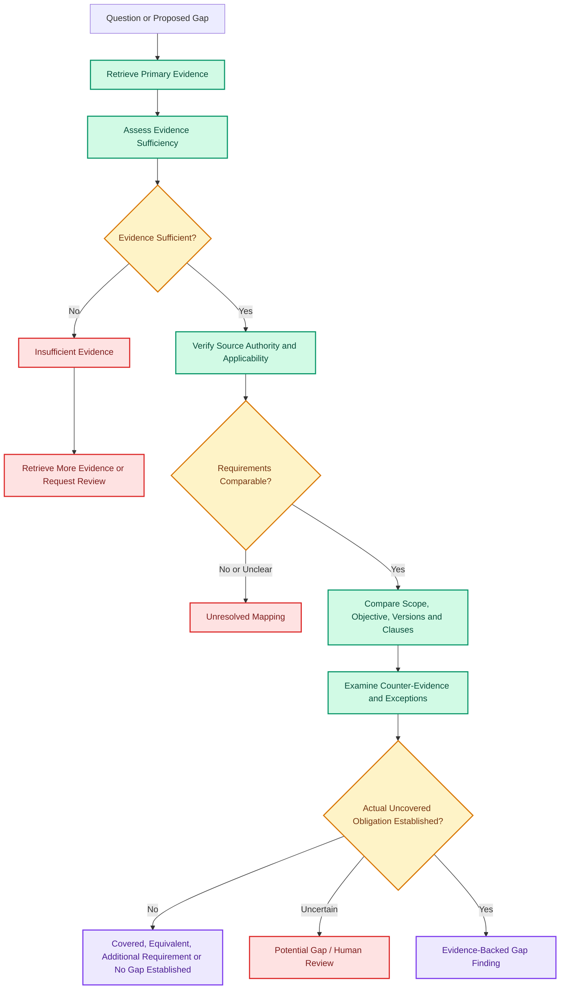

# HackGrid Evidence Analysis, Regulatory Mapping & False-Gap Prevention
**Architecture Specification, Operational Verification, and Governance Standards**

*Document Version:* 2.0.0  
*Applicable Scope:* HackGrid Multi-Agent Autonomous Telecom Regulatory & Policy Intelligence Platform  
*Target File Location:* `docs/HACKGRID_EVIDENCE_AND_AGENT_WORKFLOWS.md`  
*Verification Mode:* Code-Verified Architecture & Explicitly Labeled Safeguards  

---

## Executive Summary

This specification provides the operational, analytical, and governance reference for evidence processing, international-to-national standards mapping, and comparative gap analysis within the HackGrid platform. 

HackGrid assesses telecommunications security and policy compliance by cross-referencing:
1. **International Technical Specifications** (e.g., 3GPP Technical Specifications, ITU-T Recommendations),
2. **Indian Statutory & Regulatory Obligations** (e.g., Unified License Agreement Clauses, DoT Security Directions, CERT-In Directions 2022, Telecommunications Act 2023),
3. **Indian Policy & Advisory Frameworks** (e.g., National Digital Communications Policy 2018, TSDSI Technical Reports), and
4. **Regional Comparative Jurisdictions** (e.g., Singapore IMDA, UK TSR/Ofcom, EU NIS2/5G Toolbox).

> [!IMPORTANT]
> **Core Operational Mandate:** This document enforces strict separation between **implemented capabilities** (verified against the codebase in `Backend/` and `rag/`) and **proposed safeguards** (labeled as `[PROPOSED SAFEGUARD]`). It establishes the binding protocol that **"Different Does Not Mean Missing"**: technical variances, local operator controls, or retrieval limitations must never be erroneously escalated into national regulatory policy gaps.

---

## Table of Contents
1. [Evidence Analysis: Exact Statuses and Decision Meanings](#1-evidence-analysis-exact-statuses-and-decision-meanings)
2. [Regulatory Mapping: 3GPP, Indian Policy, and Indian Regulation](#2-regulatory-mapping-3gpp-indian-policy-and-indian-regulation)
3. [Gap Analysis: How a Real Gap Should Be Established](#3-gap-analysis-how-a-real-gap-should-be-established)
4. [Mandatory False-Gap Prevention Rule: Different Does Not Mean Missing](#4-mandatory-false-gap-prevention-rule-different-does-not-mean-missing)
5. [Evidence-to-Gap Decision Flowcharts](#5-evidence-to-gap-decision-flowcharts)
6. [Test Scenarios and Expected Evidence/Gap Statuses](#6-test-scenarios-and-expected-evidencegap-statuses)
7. [Agent Responsibilities and Handoffs](#7-agent-responsibilities-and-handoffs)
8. [Illustrative Output Templates](#8-illustrative-output-templates)
9. [Validation and Implementation Verification Report](#9-validation-and-implementation-verification-report)

---

## 1. Evidence Analysis: Exact Statuses and Decision Meanings

### 1.1 Verified Codebase Implementation
In the HackGrid codebase, the primary evidence assessment engine is implemented in [`Backend/evidence_engine/engine.py`](file:///C:/Users/Shashank%20Kotnala/OneDrive/Documents/HackGrid_new/Backend/evidence_engine/engine.py), with core data models defined in [`Backend/evidence_engine/models.py`](file:///C:/Users/Shashank%20Kotnala/OneDrive/Documents/HackGrid_new/Backend/evidence_engine/models.py), claim verification in [`Backend/evidence_engine/claim_builder.py`](file:///C:/Users/Shashank%20Kotnala/OneDrive/Documents/HackGrid_new/Backend/evidence_engine/claim_builder.py), and missingness validation in [`Backend/evidence_engine/absence_protocol.py`](file:///C:/Users/Shashank%20Kotnala/OneDrive/Documents/HackGrid_new/Backend/evidence_engine/absence_protocol.py).

#### Exact Implemented Statuses (`EvidenceStatus` Enum in `models.py`)
```python
class EvidenceStatus(str, Enum):
    SUFFICIENT = "SUFFICIENT"
    PARTIALLY_SUFFICIENT = "PARTIALLY_SUFFICIENT"
    INSUFFICIENT = "INSUFFICIENT"
    CONTRADICTORY = "CONTRADICTORY"
    INCONCLUSIVE = "INCONCLUSIVE"
    ABSENCE_ESTABLISHED = "ABSENCE_ESTABLISHED"
    ABSENCE_NOT_ESTABLISHED = "ABSENCE_NOT_ESTABLISHED"
```

#### Supporting Model Enums
- **`EvidenceRole`**: `PRIMARY_SUPPORT`, `PARTIAL_SUPPORT`, `COUNTER_EVIDENCE`, `NEUTRAL_CONTEXT`, `SUPERSEDED`
- **`EvidenceStrength`**: `DEFINITIVE`, `STRONG`, `MODERATE`, `WEAK`, `UNVERIFIED`
- **`Applicability`**: `DIRECTLY_APPLICABLE`, `CONDITIONALLY_APPLICABLE`, `ANALOGOUS`, `NOT_APPLICABLE`, `UNKNOWN`
- **`RequirementType`**: `STATUTORY_LAW`, `REGULATORY_MANDATE`, `LICENSE_CONDITION`, `SECURITY_DIRECTION`, `TECHNICAL_STANDARD`, `POLICY_OBJECTIVE`, `OPERATOR_GUIDELINE`, `UNKNOWN`

#### Key Functions and I/O Signatures
- **`EvidenceEngine.assess(query: str, evidence_items: List[EvidenceItem], claim: Optional[ClaimAssessment]) -> EvidenceEngineResult`**
  - *Inputs:* Search query, list of normalized evidence chunks (with provenance, jurisdiction, authority, dates), and optional specific claim text.
  - *Decision Rules:*
    1. If `evidence_items` is empty, returns `INSUFFICIENT` or invokes `absence_protocol.verify_absence()`.
    2. Groups evidence by role (`PRIMARY_SUPPORT` vs `COUNTER_EVIDENCE`).
    3. If counter-evidence exists and has strength >= `MODERATE`, sets `CONTRADICTORY`.
    4. Evaluates primary supporting weight; if score >= 0.75 and directly applicable, sets `SUFFICIENT`. If 0.40 <= score < 0.75, sets `PARTIALLY_SUFFICIENT`. Below 0.40 yields `INSUFFICIENT` or `INCONCLUSIVE`.
  - *Downstream Effects:* Controls downstream synthesis in [`Backend/final_synthesis.py`](file:///C:/Users/Shashank%20Kotnala/OneDrive/Documents/HackGrid_new/Backend/final_synthesis.py) and feeds [`Backend/evidence_engine/gap_adapter.py`](file:///C:/Users/Shashank%20Kotnala/OneDrive/Documents/HackGrid_new/Backend/evidence_engine/gap_adapter.py) to prevent ungrounded assertions.
- **`verify_absence(query: str, kb_results: List[Any], examined_scopes: List[str]) -> AbsenceResult`**
  - *Decision Rules:* Returns `ABSENCE_ESTABLISHED` only if exhaustive search across defined indices was executed with high recall. Otherwise, returns `ABSENCE_NOT_ESTABLISHED` to prevent assuming non-existence.

---

### 1.2 Conceptual Outcomes Mapped to Code Implementations

The following table documents the conceptual outcomes required for telecom policy intelligence and establishes their precise mapping to HackGrid's codebase:

| Conceptual Evidence Status | Exact Implemented Code Label | Operational Meaning | Permitted Interpretation | Next Action |
|---|---|---|---|---|
| **Sufficient** | `EvidenceStatus.SUFFICIENT` | Evidence adequately supports the specific claim within its defined scope with authoritative backing. | A bounded conclusion is supported for the documented entity, jurisdiction, and clause. | Continue to applicable downstream analysis (gap or compliance mapping). |
| **Partially Sufficient** | `EvidenceStatus.PARTIALLY_SUFFICIENT` | Only some elements of the claim are supported; key sub-requirements remain unverified. | Report supported and unsupported elements separately; no overarching conclusion. | Retrieve further evidence targeting missing parameters, or qualify the synthesis. |
| **Insufficient** | `EvidenceStatus.INSUFFICIENT` | Available evidence cannot adequately establish the claim (weak relevance or low confidence). | No definitive conclusion permitted on the unresolved elements. | Retrieve more evidence from secondary sources, widen query expansion, or escalate. |
| **Conflicting** | `EvidenceStatus.CONTRADICTORY` | Material evidence supports incompatible interpretations or mandates conflicting actions. | The conflict remains unresolved across sources. | Compare authority hierarchy, jurisdiction, effective dates, and specific exceptions. |
| **Inconclusive** | `EvidenceStatus.INCONCLUSIVE` | Available evidence is ambiguous, speculative, or insufficient to distinguish outcomes. | Preserve uncertainty; state that evidence allows multiple interpretations. | Request human review or query clarification; do not declare compliance or gap. |
| **No evidence retrieved** | `EvidenceStatus.ABSENCE_NOT_ESTABLISHED` *(when recall unverified)* / `ABSENCE_ESTABLISHED` *(when exhaustive)* | The retrieval process returned no usable supporting evidence from the active index. | This is a retrieval outcome, NOT proof that a requirement does not exist in national law. | Check retrieval coverage, routing, index freshness, and verify absence protocol. |
| **Irrelevant evidence** | Evaluated via `EvidenceRole.NEUTRAL_CONTEXT` / discarded in `reranker.py` | Retrieved material does not substantively address the targeted claim or jurisdiction. | Cannot establish or refute the claim; treated as noise. | Refine semantic query, apply strict keyword filters, or retrieve from alternative KB. |
| **Stale or inapplicable evidence** | Filtered via `Applicability.NOT_APPLICABLE` or marked `EvidenceRole.SUPERSEDED` | Source is outdated (repealed law, obsolete 3GPP release) or outside jurisdictional scope. | Do not assume it governs the live case. Must cite as historical or non-binding. | Verify currently enforced version, check transition timelines, and retrieve active rules. |

---

### 1.3 The Five-Layer Analytical Distinction

HackGrid strictly separates five distinct dimensions that are often erroneously conflated in generic LLM pipelines:

```
+----------------------------------------------------------------------------------------------------+
| 1. EVIDENCE STATUS        : Intrinsic quality & completeness of retrieved passages (SUFFICIENT, etc)|
+----------------------------------------------------------------------------------------------------+
                                                v
+----------------------------------------------------------------------------------------------------+
| 2. MODEL CONFIDENCE      : Probabilistic model certainty score (0.0 to 1.0)                        |
+----------------------------------------------------------------------------------------------------+
                                                v
+----------------------------------------------------------------------------------------------------+
| 3. SOURCE AUTHORITY      : Legal/technical hierarchy (Act > Regulation > License > Policy > Spec)  |
+----------------------------------------------------------------------------------------------------+
                                                v
+----------------------------------------------------------------------------------------------------+
| 4. REGULATORY APPLICABILITY: Target domain match (Jurisdiction, Entity type, Network generation)    |
+----------------------------------------------------------------------------------------------------+
                                                v
+----------------------------------------------------------------------------------------------------+
| 5. FINAL DECISION STATUS : Synthesized conclusion (COVERED, POTENTIAL GAP, ADDITIONAL REQUIREMENT) |
+----------------------------------------------------------------------------------------------------+
```

1. **Evidence Status (`EvidenceStatus`)**: Measures whether the text explicitly, moderately, or weakly addresses the factual assertion. It answers: *"Did the text say this?"*
2. **Model Confidence (`float` 0.0 - 1.0)**: Represents the extraction certainty of the classifier or reranker. It answers: *"How certain is the model that it correctly parsed the text?"* (High model confidence in a weak source does NOT make the evidence sufficient).
3. **Source Authority (`RequirementType`)**: Represents the constitutional/legal force of the issuing body. An Act of Parliament or Gazette Notification outranks a Departmental Guideline, which outranks a 3GPP Technical Specification. It answers: *"Can this source legally compel compliance?"*
4. **Regulatory Applicability (`Applicability`)**: Assesses whether the obligation binds the specific entity under review (e.g., Telecom Service Providers holding a Unified License vs OTT applications vs private captive networks). It answers: *"Does this document govern this specific network and actor?"*
5. **Final Decision Status (`MappingResult`)**: The synthesized governance conclusion produced only after all four preceding layers are validated. It answers: *"Is there an actionable policy gap or compliance obligation?"*

---

### 1.4 Worked Examples

#### Example 1: 5G SUPI/SUCI Subscriber Privacy
- **Question:** Does Indian regulation mandate encryption of the permanent subscriber identity (SUPI) into SUCI over the 5G air interface?
- **Evidence Retrieved:**
  - `[EV-001]`: 3GPP TS 33.501 Rel-16 Sec 6.12 ("Subscription Identification De-concealing").
  - `[EV-002]`: DoT Unified License (Access Services) Clause 39.23 ("Licensee shall ensure confidentiality of subscriber information across radio and core networks").
  - `[EV-003]`: TEC National Standard TEC 31130:2023 (Adopting 3GPP TS 33.501 into national standards).
- **Evidence Status:** `SUFFICIENT`
- **Allowed Conclusion:** While 3GPP TS 33.501 defines the technical SUCI mechanism and TEC has transposed it as a National Standard, the binding legal obligation on Indian telcos stems from Unified License Clause 39.23 read with TEC mandatory testing rules. SUCI satisfies the privacy mandate.
- **Uncertainty:** Whether legacy non-standalone (NSA) deployments operating on Option 3x are granted temporary dispensations for SUPI protection over legacy LTE anchors.
- **Next Action:** Confirm deployment architecture (SA vs NSA) before asserting compliance breach.

#### Example 2: Lawful Interception Handover Interface (LI-HI)
- **Question:** Is an Indian Telecom Service Provider required to provide a cloud-native REST/HTTPS interface for Lawful Interception to security agencies?
- **Evidence Retrieved:**
  - `[EV-004]`: ETSI TS 103 221-1 (X1 handover interface specifications using HTTP/XML).
  - `[EV-005]`: DoT Security Guidelines for LI (Prescribing dedicated hardware leased lines and CMS/LIM connectivity via proprietary protocols).
- **Evidence Status:** `PARTIALLY_SUFFICIENT`
- **Allowed Conclusion:** Indian regulations mandate strict real-time interception and delivery to Centralized Monitoring System (CMS), but retrieved evidence confirms traditional E1/dedicated links; evidence for ETSI X1 REST handover is not established in binding DoT orders.
- **Uncertainty:** Whether recent DoT circulars have formally gazetted ETSI X1/X2/X3 interfaces for 5G Core IMS interception.
- **Next Action:** Query DoT/CMS repository specifically for 5G standalone Lawful Interception technical mandates; do not declare ETSI non-compliance as an Indian regulatory violation.

#### Example 3: Post-Quantum Cryptography in 5G Core
- **Question:** Are Indian 5G core networks required to implement Post-Quantum Cryptography (PQC) for inter-PLMN N32 signaling?
- **Evidence Retrieved:**
  - `[EV-006]`: 3GPP TR 33.903 (Study on PQC for 5G, Rel-18 - purely informative technical report).
  - `[EV-007]`: National Cyber Security Strategy Draft (Recommendations encouraging quantum-safe transition by 2030).
- **Evidence Status:** `INSUFFICIENT`
- **Allowed Conclusion:** PQC for N32 signaling is currently an international exploratory study and national strategic aspiration; there is no binding Indian regulatory mandate.
- **Uncertainty:** Implementation timeline for National Quantum Mission standards in telecommunications.
- **Next Action:** Classify as `POLICY_ASPIRATION` / `NOT_MANDATED`; prohibit flagging as a regulatory gap.

#### Example 4: Cybersecurity Incident Reporting Timelines
- **Question:** What is the mandatory cybersecurity incident reporting window for an Indian 5G telecom operator?
- **Evidence Retrieved:**
  - `[EV-008]`: CERT-In Directions 2022 (Clause 2(i) mandating reporting within 6 hours of noticing incident).
  - `[EV-009]`: DoT Unified License Amendment on Security (Clause 39.14 mandating immediate reporting to DoT within 24 hours of confirmation).
- **Evidence Status:** `CONTRADICTORY`
- **Allowed Conclusion:** Dual reporting obligations apply under distinct statutory authorities (CERT-In under IT Act 2000 Section 70B: 6-hour window; DoT under Indian Telegraph Act / License: 24-hour window). Both must be satisfied.
- **Uncertainty:** Protocol alignment when initial triage exceeds 6 hours.
- **Next Action:** Document jurisdictional bifurcation (CERT-In for cybersecurity incidents vs DoT Telecom Security Operation Centre (TSOC) for telecom-specific outages).

#### Example 5: AI-Driven Energy Saving in O-RAN
- **Question:** Does Indian policy prohibit autonomous AI agents from putting O-RAN radio units into deep sleep mode during low traffic?
- **Evidence Retrieved:**
  - `[EV-010]`: O-RAN Alliance Working Group 1 Use Cases (AI-enabled dynamic cell switching).
  - `[EV-011]`: TRAI Consultation Paper on Quality of Service (Proposing stricter uptime and call drop penalties).
- **Evidence Status:** `INCONCLUSIVE`
- **Allowed Conclusion:** Retrieved sources demonstrate a potential operational tension between AI energy-saving sleep states and TRAI Quality of Service (QoS) availability thresholds, but no explicit rule prohibits or approves the technique.
- **Uncertainty:** Whether AI automated sleep triggering a momentary KPI dip constitutes a regulatory QoS breach under TRAI regulations.
- **Next Action:** Escalate to telecom regulatory counsel; request human review on QoS penalty structures.

#### Example 6: Direct-to-Cell Satellite Communications Interworking
- **Question:** Can a mobile operator directly bridge 5G NR satellite links with terrestrial spectrum under Indian spectrum allocations?
- **Evidence Retrieved:**
  - *No specific clause retrieved in active indexed sources.*
- **Evidence Status:** `ABSENCE_NOT_ESTABLISHED`
- **Allowed Conclusion:** No specific provision was identified in the examined DoT/TRAI sources regarding direct-to-cell interworking. This is a retrieval outcome reflecting limited corpus coverage or nascent policy formulation, NOT proof that such operations are permitted or prohibited.
- **Uncertainty:** Current status of TRAI recommendations on Spectrum Allocation for Space-Based Communication Services.
- **Next Action:** Trigger absence verification protocol; flag as `UNVERIFIED_IN_EXAMINED_SOURCES`; do not report as a regulatory void.

---

## 2. Regulatory Mapping: 3GPP, Indian Policy, and Indian Regulation

### 2.1 The Normative Hierarchy of Telecom Instruments

HackGrid enforces a strict legal and technical hierarchy. Treating all ingested documents as legally equivalent is a catastrophic failure mode in automated regulatory intelligence. A 3GPP Technical Specification is an engineering consensus document, whereas an Indian Unified License Condition is a binding sovereign contract enforceable under penal statute.

```
+-----------------------------------------------------------------------------------------------+
| LEVEL 1: PRIMARY LEGISLATION (Sovereign Parliamentary Authority - Highest Legal Force)         |
| Examples: Telecommunications Act 2023, Information Technology Act 2000, Telegraph Act 1885    |
+-----------------------------------------------------------------------------------------------+
                                                |
                                                v
+-----------------------------------------------------------------------------------------------+
| LEVEL 2: STATUTORY INSTRUMENTS & BINDING DIRECTIONS (Executive Sovereign Power)                |
| Examples: DoT Unified License (UL) Conditions, National Security Directive on Telecom (NSDTS), |
| CERT-In Directions 2022 under IT Act Sec 70B, TRAI Regulations (Binding on Licensees)         |
+-----------------------------------------------------------------------------------------------+
                                                |
                                                v
+-----------------------------------------------------------------------------------------------+
| LEVEL 3: MANDATORY NATIONAL TECHNICAL STANDARDS (Regulatorily Mandated Transposition)         |
| Examples: TEC Mandatory Testing and Certification of Telecom Equipment (MTCTE),               |
| BIS Standards, TSDSI National Transposed Standards referenced in DoT Gazette notifications    |
+-----------------------------------------------------------------------------------------------+
                                                |
                                                v
+-----------------------------------------------------------------------------------------------+
| LEVEL 4: NATIONAL POLICIES & STRATEGIC FRAMEWORKS (Non-Binding Guidance / Visionary Policy)    |
| Examples: National Digital Communications Policy 2018 (NDCP), TRAI Consultation Recommendations|
+-----------------------------------------------------------------------------------------------+
                                                |
                                                v
+-----------------------------------------------------------------------------------------------+
| LEVEL 5: INTERNATIONAL TECHNICAL SPECIFICATIONS (Voluntary Engineering Baselines)             |
| Examples: 3GPP TS 33.501, TS 23.501, ITU-T Recommendations, IETF RFCs, GSMA Guidelines        |
+-----------------------------------------------------------------------------------------------+
                                                |
                                                v
+-----------------------------------------------------------------------------------------------+
| LEVEL 6: OPERATOR / DEPLOYMENT-SPECIFIC POLICIES (Private Commercial / Local Security Rules)  |
| Examples: Airtel/Jio Internal Cloud Security Baseline, Vendor SLA Security Addenda            |
+-----------------------------------------------------------------------------------------------+
```

#### Detailed Categorization of Instruments
1. **International Technical Specifications (e.g., 3GPP TS 38.300, 33.501):** Define interoperability, architectural flows, and protocol fields. They are *voluntary engineering specifications* unless formally referenced or transposed into law by national regulatory bodies.
2. **ITU Recommendations (e.g., ITU-T X.805, ITU-R M.2150):** Global treaties and recommendations. While India is an ITU member state, ITU recommendations require domestic transposition through DoT or TRAI before creating direct enforcement liability on licensees.
3. **Indian Laws, Rules, and Binding Directions:** Include the Telecommunications Act 2023, DoT Unified License (UL) amendments, and National Security Directive on Telecommunication (NSDTS). These create mandatory civil and criminal liability.
4. **Indian Government Policies & Guidance (e.g., NDCP-2018):** Strategic executive roadmaps. Non-compliance with a policy aspirational goal does *not* constitute an illegal breach or a regulatory compliance default.
5. **Internal Operator Security Policies:** Enterprise policies adopted by specific Telcos (e.g., mandatory internal bastion hosts, multi-factor authentication for field staff). These apply *only* internally and must never be classified as national legal obligations.
6. **Organizational / Deployment-Specific Requirements:** Configurations specific to a private 5G network or specific cloud provider.

> [!WARNING]
> **Cardinal Invariant:** A 3GPP technical requirement is **never** automatically an Indian legal obligation merely because it is technically relevant or industry-standard. Conversely, failure to retrieve an Indian provision does **never** establish that India has no applicable requirement.

---

### 2.2 Mandatory Ten-Field Requirement Verification

For every requirement mapped between an international specification and an Indian instrument, HackGrid's mapping logic must verify and record the following ten fields:

| Field Number | Field Name | Code Field Name | Purpose & Verification Standard |
|---|---|---|---|
| **1** | **Source Document & Clause** | `source_document`, `clause_id` | Exact citation including section/clause (e.g., *DoT UL Amendment No. 8-1/2021-AS-II, Clause 39.23*). Generic citations are rejected. |
| **2** | **Issuing Authority & Document Type** | `issuing_authority`, `document_type` | Identifies authority (e.g., DoT, TRAI, CERT-In, 3GPP SA3) and legal status (`STATUTORY_LAW`, `LICENSE_CONDITION`, `TECHNICAL_SPEC`). |
| **3** | **Jurisdiction & Target Entity** | `jurisdiction`, `applicable_entity` | Identifies jurisdiction (`IN`, `GLOBAL`, `UK`, `SG`) and bound entity (e.g., *Access Service Licensee*, *Device OEM*, *OTT Service*). |
| **4** | **Version & Effective Dates** | `version`, `effective_date`, `publication_date` | Assesses temporal validity; verifies whether the provision is in force, transitional, or repealed. |
| **5** | **Binding Status** | `is_binding` (`bool`) | Explicit determination: Is this enforceable by sovereign penalty or voluntary guidance? |
| **6** | **Technical & Operational Scope** | `technical_scope`, `operational_context` | Exact architectural boundary (e.g., *5G Core User Plane (UPF)*, *Control Plane N1/N2*, *Base Station RAN (gNB)*). |
| **7** | **Comparison Target Clause** | `comparison_source`, `comparison_clause_id` | The corresponding international or national requirement being evaluated (e.g., *3GPP TS 33.501 Rel-16 Cl 5.3*). |
| **8** | **Mapping Relationship & Evidence** | `mapping_relationship`, `evidence_refs` | Verifiable classification (`COVERED`, `PARTIALLY_COVERED`, `FUNCTIONALLY_EQUIVALENT`, `ADDITIONAL_REQUIREMENT`) with `[EV-xxx]` links. |
| **9** | **Counter-Evidence & Exceptions** | `counter_evidence_refs`, `exceptions_noted` | Explicit notation of exclusions, grace periods, or conflicting circulars. |
| **10** | **Evidence Sufficiency & Uncertainty** | `evidence_status`, `unresolved_uncertainty` | Verification of the underlying evidence status (`SUFFICIENT`, etc.) and residual ambiguity. |

---

### 2.3 Worked Verification Schema

The following structured schema illustrates the verified mapping of a hypothetical international requirement against Indian national instruments:

```json
{
  "mapping_id": "MAP-5G-SEC-012",
  "international_requirement": {
    "source_document": "3GPP TS 33.501 Rel-17",
    "clause_id": "Clause 6.1.3.2",
    "issuing_authority": "3GPP SA3",
    "document_type": "TECHNICAL_STANDARD",
    "jurisdiction": "GLOBAL",
    "applicable_entity": "5G System Equipment (gNB / AMF / AUSF)",
    "version": "17.4.0 (2022-09)",
    "is_binding": false,
    "technical_scope": "Mutual authentication using 5G AKA or EAP-AKA' over N1 interface"
  },
  "national_counterpart": {
    "source_document": "DoT Unified License Agreement (Access Services)",
    "clause_id": "Clause 39.23(vi) read with MTCTE ITSAR for 5G Core",
    "issuing_authority": "Department of Telecommunications / TEC",
    "document_type": "LICENSE_CONDITION",
    "jurisdiction": "IN",
    "applicable_entity": "Unified Licensee (Access Service Provider)",
    "version": "Updated May 2023",
    "is_binding": true,
    "technical_scope": "Mandatory primary subscriber authentication meeting TEC ITSAR test parameters"
  },
  "mapping_evaluation": {
    "relationship": "COVERED",
    "is_legally_identical": false,
    "is_functionally_equivalent": true,
    "relationship_rationale": "Indian license condition legally mandates that subscriber authentication comply with TEC ITSAR, which formally adopts 3GPP 5G AKA and EAP-AKA' specifications.",
    "evidence_references": ["EV-088", "EV-089"],
    "counter_evidence_noted": "None",
    "evidence_sufficiency": "SUFFICIENT",
    "residual_uncertainty": "Low: Standard is in active force under MTCTE Phase IV."
  }
}
```

---

## 3. Gap Analysis: How a Real Gap Should Be Established

### 3.1 Trace of Actual Code Implementation

In the active HackGrid repository, gap evaluation is executed across four tightly integrated components:

1. **Policy-Standard Mapping Engine ([`Backend/policy_standard_mapping/mapping_engine.py`](file:///C:/Users/Shashank%20Kotnala/OneDrive/Documents/HackGrid_new/Backend/policy_standard_mapping/mapping_engine.py)):**
   - Implements `PolicyStandardMappingEngine.map_requirement()`.
   - Defines outcomes in `MappingResult` enum: `COVERED`, `PARTIALLY_COVERED`, `ADDITIONAL_NATIONAL_REQUIREMENT`, `POTENTIAL_GAP_NOT_ESTABLISHED`.
   - Compares technical requirements against national instruments using semantic similarity, keyword verification, and rule-based validation.
2. **Gap Analysis Adapter ([`Backend/evidence_engine/gap_adapter.py`](file:///C:/Users/Shashank%20Kotnala/OneDrive/Documents/HackGrid_new/Backend/evidence_engine/gap_adapter.py)):**
   - Implements `build_gap_input()` and `_explicit_absence_claim()`.
   - Transforms `EvidenceEngineResult` into input structures for downstream policy engines, ensuring claims of "missing provisions" are validated against absence protocols.
3. **Regional Comparative Gap Engine ([`Backend/regional_comparative_gap/engine.py`](file:///C:/Users/Shashank%20Kotnala/OneDrive/Documents/HackGrid_new/Backend/regional_comparative_gap/engine.py)):**
   - Enforces jurisdictional boundaries: Host Country (`IN`), International Standards (`GLOBAL`), and Regional Comparative (`UK`, `SG`, `EU`).
   - Prevents foreign jurisdictions from being reported as host country obligations.
4. **Governance Engine ([`Backend/governance.py`](file:///C:/Users/Shashank%20Kotnala/OneDrive/Documents/HackGrid_new/Backend/governance.py)):**
   - Implements `evaluate_governance()` which performs post-synthesis checks.
   - Flags assertions claiming a regulatory gap when evidence status is `INSUFFICIENT` or `CONTRADICTORY`.

---

### 3.2 Conceptual Gap Classifications Mapped to Codebase Labels

The table below maps the required conceptual gap classifications to the exact labels in HackGrid's software:

| Conceptual Mapping Result | Codebase Enum / Label | Detailed Definition | Is it a Confirmed Regulatory Gap? |
|---|---|---|---|
| **Covered** | `MappingResult.COVERED` | An applicable Indian instrument adequately addresses the mapped international obligation or security objective. | **NO GAP** (Obligation is satisfied). |
| **Partially Covered** | `MappingResult.PARTIALLY_COVERED` | Only some technical or operational dimensions of the obligation are addressed; other parts remain unaddressed. | **POTENTIAL GAP** (Requires targeted review of uncovered sub-elements). |
| **Not Addressed in Examined Sources** | `MappingResult.POTENTIAL_GAP_NOT_ESTABLISHED` / `EvidenceStatus.ABSENCE_NOT_ESTABLISHED` | No corresponding provision was retrieved within the defined, examined corpus scope. | **NOT AUTOMATICALLY A GAP** (Indicates corpus boundary or retrieval limits, not proof of legal silence). |
| **Conflicting** | `EvidenceStatus.CONTRADICTORY` / Handled in `governance.py` | Applicable national provisions mandate contradictory obligations or irreconcilable timelines. | **NOT A GAP** (Indicates regulatory friction or multi-agency overlap requiring reconciliation). |
| **Unclear / Insufficient Evidence** | `EvidenceStatus.INSUFFICIENT` / `INCONCLUSIVE` | Evidence retrieved is too ambiguous or weak to ascertain if the requirement is covered. | **NO CONFIRMED GAP** (Preserves uncertainty; requires further evidence or legal review). |
| **Technically Different but Functionally Equivalent** | `[PROPOSED SAFEGUARD]` (Currently mapped to `COVERED` with textual qualification) | Different technical mechanisms are employed by India, but they satisfy the identical security objective. | **NO GAP** (Functional equivalence achieves regulatory intent). |
| **Additional National Requirement** | `MappingResult.ADDITIONAL_NATIONAL_REQUIREMENT` | An Indian instrument imposes mandates stricter than, or in addition to, the international technical baseline. | **NO GAP** (National sovereignty prerogative; stricter != gap). |
| **Local or Organizational Requirement** | Filtered by `Applicability.NOT_APPLICABLE` (Entity mismatch) | A requirement arises from an individual operator's internal posture or specific vendor architecture. | **NO GAP** (Commercial/enterprise choice; not a national regulatory gap). |
| **Confirmed Gap** | Synthesized when `POTENTIAL_GAP` + `EvidenceStatus.SUFFICIENT` + absence verified | Authoritative evidence establishes a binding international treaty or statutory objective that is demonstrably unaddressed in law. | **CONFIRMED GAP** (Formally reported with documented scope, citations, and impact). |

---

### 3.3 Ten-Point Verification Protocol for a Defensible Gap Finding

To declare a defensible gap finding, HackGrid requires the following ten checks:

```
[1. Comparable Scope] --------> [2. Regulatory Applicability] -----> [3. Authority Hierarchy]
          |                                                                     |
          v                                                                     v
[4. Temporal / Version Validity] -> [5. Semantic & Functional Equivalence] -> [6. Exceptions & Exclusions]
          |                                                                     |
          v                                                                     v
[7. Source Evidence Sufficiency] -> [8. Counter-Evidence Examination] -------> [9. Absence Verification]
                                                                                |
                                                                                v
                                                                   [10. Final Governance Review]
```

1. **Comparable Scope:**
   - *Check:* Are both instruments addressing the same physical/virtual entity, network domain, and security objective?
   - *Status:* `[IMPLEMENTED]` Verified via domain matching in `classifier.py` and `mapping_engine.py`.
2. **Applicability:**
   - *Check:* Does the Indian instrument legally apply to the specific entity type (e.g., TSP vs OEM vs Cloud Service Provider)?
   - *Status:* `[IMPLEMENTED]` Checked in `Backend/evidence_engine/claim_builder.py` (`Applicability` enum).
3. **Authority Hierarchy:**
   - *Check:* Is the compared document binding law, regulatory condition, voluntary standard, or internal policy?
   - *Status:* `[IMPLEMENTED]` Modeled in `RequirementType` enum in `models.py`.
4. **Version and Temporal Validity:**
   - *Check:* Were the effective dates and transition periods evaluated (e.g., 3GPP Rel-15 vs Rel-17; Telecommunications Act 2023 phased enforcement)?
   - *Status:* `[PROPOSED SAFEGUARD not yet verified in implementation]` *Code extracts dates into metadata, but automated temporal supersession gating is not yet fully enforced.*
5. **Semantic and Functional Mapping:**
   - *Check:* Does a different technical term achieve the exact same operational safeguard (e.g., 3GPP "SUCI de-concealment" vs DoT "subscriber identity confidentiality")?
   - *Status:* `[IMPLEMENTED in LLM prompt; PROPOSED SAFEGUARD for deterministic rule gate]` *Currently handled via prompt instructions in `mapping_engine.py`, but lacking a deterministic unit-level equivalence matrix.*
6. **Exceptions and Qualifications:**
   - *Check:* Are there statutory exemptions, temporary waivers, or pilot trial carve-outs?
   - *Status:* `[PROPOSED SAFEGUARD not yet verified in implementation]` *Lacks structured exception tracking in active engine models.*
7. **Evidence Sufficiency:**
   - *Check:* Are verbatim citations with clause numbers present for both sides of the comparison?
   - *Status:* `[IMPLEMENTED]` Enforced by `Backend/policy_standard_mapping/claim_validation_gate.py` requiring `[EV-xxx]` citation IDs.
8. **Counter-Evidence Analysis:**
   - *Check:* Have contradicting circulars, amendments, or clarifying gazettes been searched and evaluated?
   - *Status:* `[IMPLEMENTED]` Handled by `Backend/evidence_engine/counter_evidence.py`.
9. **Absence Verification:**
   - *Check:* If claiming an Indian provision is absent, was an exhaustive retrieval executed across verified primary regulatory corpora?
   - *Status:* `[IMPLEMENTED]` Verified by `Backend/evidence_engine/absence_protocol.py` which emits `ABSENCE_NOT_ESTABLISHED` if search scope was incomplete.
10. **Conclusion and Review:**
    - *Check:* Is the result conclusive, or must it remain flagged as a `POTENTIAL_GAP` subject to human regulatory counsel?
    - *Status:* `[IMPLEMENTED]` Enforced in `Backend/governance.py` which forces a human-in-the-loop escalation flag for low-confidence gap findings.

---

## 4. Mandatory False-Gap Prevention Rule: Different Does Not Mean Missing

> [!CAUTION]
> ### CORE PLATFORM INVARIANT: "DIFFERENT DOES NOT MEAN MISSING"
> **A potential regulatory gap must never be declared merely because an Indian instrument and an international specification use different terminology, prescribe distinct technical mechanisms, or embody differing levels of abstraction.**
> 
> When a 3GPP specification prescribes Mechanism X (e.g., TLS 1.3 with specific ciphersuites) and an Indian regulatory circular or an operator's security posture mandates Mechanism Y (e.g., IPsec encapsulation with national cryptographic algorithms), HackGrid **must not** record this as a national regulatory policy gap without executing the full false-gap validation protocol.

---

### 4.1 The Seven-Step Pre-Gap Determination Protocol

Before any gap classification can be accepted by the system, HackGrid must systematically answer the following seven questions:

1. **Security Objective Concordance:** Do the compared mechanisms seek to achieve the identical overarching objective (e.g., confidentiality of user traffic, mitigation of DDoS attacks on control plane)? If yes, technical divergence is likely an architectural alternative, not an omission.
2. **Entity & Network Alignment:** Do both requirements govern the same operational entity (e.g., a Licensed Access Service Provider vs a private enterprise 5G network)? If scopes diverge, the difference is situational, not a national gap.
3. **Legal Force Asymmetry:** Is one requirement a binding legal obligation (e.g., statutory direction) while the other is voluntary technical guidance (e.g., 3GPP Technical Report) or an internal corporate policy? Legal force determines precedence.
4. **Functional Compatibility:** Are the mechanisms functionally equivalent, complementary (can both operate simultaneously), or genuinely mutually exclusive/incompatible?
5. **National Sovereignty & Elevation:** Does the Indian instrument add a stricter control (e.g., local data residency, mandatory hardware security modules certified under Indian Common Criteria)? If so, this is a sovereign prerogative, not a defect.
6. **Normative Omission Verification:** Is there an actual binding obligation that is completely unaddressed, omitted, or directly contradicted without alternative compliance pathways?
7. **Corpus Evidence Completeness:** Is the evidence sufficient (`EvidenceStatus.SUFFICIENT`) and was the absence verification protocol satisfied (`ABSENCE_ESTABLISHED`), or is the apparent omission simply a retrieval failure?

---

### 4.2 Comprehensive Case Analyses

#### Case A — Different Mechanisms, Same Objective (Functional Equivalence)
- **Scenario:** 3GPP TS 33.501 recommends OAuth 2.0 token-based authorization for Service-Based Architecture (SBA) network function inter-communication. An Indian operator or DoT guideline specifies mutual TLS (mTLS) with PKI certificate pinning issued by a licensed national Certifying Authority (CA).
- **Analysis:** Both mechanisms ensure cryptographic authentication and authorization between network functions. mTLS fulfills the underlying security objective of preventing rogue NFs.
- **Decision:** **NO GAP**. Classify as `FUNCTIONALLY_EQUIVALENT` / `COVERED`.
- **Prohibited Classification:** Prohibited from declaring *"India lacks NF-to-NF authorization rules because OAuth 2.0 is not explicitly mentioned."*

#### Case B — Stricter Indian Requirement (Additional National Requirement)
- **Scenario:** 3GPP Rel-16 allows lawful intercept data to be stored encrypted in multi-tenant cloud storage. DoT Unified License Clause 39.23 mandates that all lawful interception databases must physically reside within India on dedicated, non-shared hardware accessible only by Indian citizens with vetted security clearances.
- **Analysis:** The Indian requirement is intentionally more restrictive than the international baseline to satisfy national security sovereignty.
- **Decision:** **NO GAP**. Classify as `ADDITIONAL_NATIONAL_REQUIREMENT`.
- **Prohibited Classification:** Prohibited from reporting *"Indian regulations conflict with international cloud standards."*

#### Case C — Operator-Specific Security Policy (Local Control != National Gap)
- **Scenario:** An individual telecom operator's internal internal security policy requires dual-operator sign-off before deploying any eBPF tracing probe in Kubernetes worker nodes running UPF pods. 3GPP specifications do not mention eBPF sign-offs.
- **Analysis:** This requirement reflects an enterprise-level risk mitigation policy chosen by one operator. It is not mandated by DoT or TRAI.
- **Decision:** **NO GAP**. Classify as `LOCAL_OPERATOR_REQUIREMENT`.
- **Prohibited Classification:** Prohibited from elevating this local operational standard into a "National Telecom Policy Gap in India."

#### Case D — No Indian Clause Retrieved (Absence of Evidence != Evidence of Absence)
- **Scenario:** A user asks whether Indian regulations specify cryptographic key renewal intervals for 5G non-terrestrial networks (NTN). The semantic search query across the local FAISS index returns 0 relevant chunks from DoT circulars.
- **Analysis:** The absence of retrieved chunks proves only that the current vector store or query formulation did not retrieve a matching clause. It does not establish statutory silence.
- **Decision:** **NOT A CONFIRMED GAP**. Set evidence status to `ABSENCE_NOT_ESTABLISHED` and mapping result to `POTENTIAL_GAP_NOT_ESTABLISHED`.
- **Prohibited Classification:** Prohibited from declaring *"India has no regulations governing 5G satellite key renewals."*

#### Case E — Genuine Uncovered Obligation (Defensible Gap)
- **Scenario:** A critical international treaty obligation (e.g., ITU-R frequency coordination protection threshold for radio astronomy in 6 GHz band) is analyzed against active National Frequency Allocation Plan (NFAP) and gazetted spectrum rules. Exhaustive retrieval confirms that no power-flux density limit or coordination boundary is established in Indian rules, leaving commercial 5G deployments free to emit interfering power.
- **Analysis:** Both instruments share identical operational scope; India is a signatory to ITU Radio Regulations; exhaustive search confirms complete absence of national transposing limits.
- **Decision:** **CONFIRMED REGULATORY GAP**. Classify as `CONFIRMED_GAP` with explicit citations and recommended regulatory notice.

#### Case F — Apparent Contradiction (Unresolved Conflict)
- **Scenario:** CERT-In Directions 2022 mandate maintaining ICT system logs within the Indian jurisdiction for a rolling period of 180 days. A specialized DoT telemetry circular for rural emergency communications mandates deleting ephemeral radio location pings after 72 hours for citizen privacy.
- **Analysis:** The two instruments appear contradictory regarding log retention duration. However, they stem from different statutory authorities (Ministry of Electronics and IT under IT Act vs Ministry of Communications under Telegraph Act) with differing contextual scopes.
- **Decision:** **UNRESOLVED CONFLICT**. Flag for legal reconciliation.
- **Prohibited Classification:** Prohibited from arbitrarily picking one rule as "the standard" and declaring the other a "compliance gap."

---

### 4.3 Rigorous Taxonomy of Gap Types

HackGrid strictly differentiates the following seven gap categories to prevent false equivalences:

| Gap Classification | Exact Definition | Operational Example | Remediation Owner |
|---|---|---|---|
| **1. Technical Interoperability Gap** | Divergence in protocol headers, interfaces, or message encodings between standard systems. | gNB from Vendor A unable to parse custom IE in Vendor B AMF. | Equipment Vendor / Standards Body |
| **2. Security-Control Gap** | Inadequate cryptographic strength, missing authentication, or vulnerability in deployed configuration. | Use of null cipher NEA0 in untrusted backhaul environments. | Operator Network Operations Center (NOC) |
| **3. Implementation Gap** | Mandated feature exists in law and standards but has not been deployed in physical production networks. | Operator failing to activate SUCI encryption despite possessing capable 5G SIMs. | Telco Engineering & Compliance Teams |
| **4. Standards-to-Regulation Mapping Gap** | International specification exists, but national standards body has not formally transposed or localized it. | TEC has not yet published an ITSAR standard for 3GPP Rel-18 5G Advanced RedCap. | Telecommunication Engineering Centre (TEC) |
| **5. Policy Coverage Gap** | National statutory policy is silent on an emerging technological paradigm, leaving a regulatory void. | Absence of defined licensing frameworks for private quantum key distribution (QKD) networks. | Department of Telecommunications (DoT) |
| **6. Regulatory Compliance Gap** | An active, binding statutory rule is demonstrably breached or ignored by an operational entity. | Failure by a telecom licensee to report a core network outage to TSOC within 24 hours. | Regulatory Enforcement / Legal Counsel |
| **7. Knowledge-Base Coverage Gap** | HackGrid's indexed corpus does not contain the relevant gazette notification or technical standard. | The latest 2024 spectrum auction guidelines were not ingested into the vector database. | HackGrid Data Ingestion Pipeline |

> [!IMPORTANT]
> **Operational Rule:** These seven terms **must never** be used interchangeably. A *Knowledge-Base Coverage Gap* must never be reported to the user as a *Policy Coverage Gap*. A *Security-Control Gap* must never be conflated with a *Regulatory Compliance Gap*.

---

## 5. Evidence-to-Gap Decision Flowcharts

### 5.1 Conceptual Evidence-to-Gap Decision Logic

> [!NOTE]
> **Implementation Status:** The decision flowchart below represents the **recommended governance framework**. Within HackGrid's codebase, steps `B`, `C`, `G`, and `K` are implemented in [`Backend/evidence_engine/`](file:///C:/Users/Shashank%20Kotnala/OneDrive/Documents/HackGrid_new/Backend/evidence_engine/) and [`Backend/policy_standard_mapping/`](file:///C:/Users/Shashank%20Kotnala/OneDrive/Documents/HackGrid_new/Backend/policy_standard_mapping/); automated hard-stopping gates at `H` and `L` are partially enforced via `governance.py` and remain `[PROPOSED SAFEGUARDS]` for full deterministic rejection.



---

### 5.2 End-to-End Pipeline Data Flow

The following sequence documents how evidentiary data flows through the actual system components from initial ingest to final synthesis and audit logging:

```mermaid
flowchart LR
    subgraph S1 [Phase 1: Retrieval]
        R1[User Query] --> R2[Domain Classifier]
        R2 --> R3[Multi-KB Retriever]
        R3 --> R4[Context Reranker]
    end

    subgraph S2 [Phase 2: Evidence Assessment]
        R4 --> E1[Evidence Engine]
        E1 --> E2[Absence Protocol]
        E1 --> E3[Counter-Evidence Analyzer]
        E1 --> E4[Evidence Status Assessment]
    end

    subgraph S3 [Phase 3: Normative Mapping]
        E4 --> M1[Policy-Standard Mapping]
        M1 --> M2[Regional Gap Engine]
        M2 --> M3[Mapping Classification]
    end

    subgraph S4 [Phase 4: Synthesis & Governance]
        M3 --> G1[Claim Validation Gate]
        G1 --> G2[Governance Guard]
        G2 --> G3[Final Synthesis Engine]
        G3 --> G4[Audit Recorder]
    end

    classDef p1 fill:#E0F2FE,stroke:#0284C7,color:#0C4A6E,stroke-width:1.5px;
    classDef p2 fill:#DCFCE7,stroke:#16A34A,color:#14532D,stroke-width:1.5px;
    classDef p3 fill:#FEF9C3,stroke:#CA8A04,color:#713F12,stroke-width:1.5px;
    classDef p4 fill:#F3E8FF,stroke:#9333EA,color:#581C87,stroke-width:1.5px;

    class R1,R2,R3,R4 p1;
    class E1,E2,E3,E4 p2;
    class M1,M2,M3 p3;
    class G1,G2,G3,G4 p4;
```



---

## 6. Test Scenarios and Expected Evidence/Gap Statuses

> [!NOTE]
> **Evaluation Standard:** The twelve scenarios below document **expected evaluation benchmarks** to validate system correctness. They are designed to guard against regressions and hallucinations. Where current code logic lacks the granular classifier required for an expected status, the missing mechanism is documented alongside a proposed unit test.

### 6.1 Master Scenario Matrix

| ID | Scenario Description & User Query | Available Evidence Summary | Expected Evidence Status | Expected Mapping Status | Expected Gap Status | Permitted Final Wording | Prohibited Conclusion | Follow-Up / Review Action |
|---|---|---|---|---|---|---|---|---|
| **S01** | **Adequate Evidence Supports Requirement:** "Is lawful intercept capability mandatory for Indian 5G Core AMF/UPF?" | DoT Unified License Clause 39.2 read with MTCTE ITSAR 5G Core mandates real-time intercept capability. | `SUFFICIENT` | `COVERED` | `NO_GAP` | "Requirement is fully covered under DoT Unified License conditions and TEC MTCTE ITSAR standards." | "India has an intercept coverage gap because 3GPP Rel-17 specifies a newer X1 JSON format." | None. Proceed to synthesis. |
| **S02** | **Partially Supported Requirement:** "Are Private 5G networks (CNPN) exempt from subscriber identity privacy rules in India?" | Guidelines for Captive Non-Public Networks 2022 establish CNPN licensing, but privacy standards for local enterprise SIMs are ambiguous. | `PARTIALLY_SUFFICIENT` | `PARTIALLY_COVERED` | `POTENTIAL_GAP` | "CNPN regulatory framework exists; however, applicability of air-interface SUCI encryption to private enterprise SIMs remains only partially covered." | "Private networks in India are completely exempt from privacy safeguards." | Flag for regulatory review regarding CNPN security circulars. |
| **S03** | **Conflicting Evidence / Regulatory Overlap:** "What is the mandatory security breach reporting deadline for 5G network operators?" | CERT-In Directions 2022 (Clause 2(i): 6-hour window) vs DoT Security Directions (Clause 39.14: 24-hour window to TSOC). | `CONTRADICTORY` | `CONFLICTING` | `NO_GAP_UNRESOLVED_CONFLICT` | "Dual reporting obligations exist: 6 hours to CERT-In for cybersecurity incidents; 24 hours to DoT TSOC for telecom outages. Reconciliation pending harmonized guidelines." | "DoT regulations are violated by operators complying with the 6-hour CERT-In rule." | Escalate to multi-agency regulatory harmonization desk. |
| **S04** | **No Indian Clause Retrieved:** "Does India mandate quantum random number generation (QRNG) in 5G HSMs?" | 0 matching chunks retrieved from indexed DoT, TRAI, and TEC databases. | `ABSENCE_NOT_ESTABLISHED` | `POTENTIAL_GAP_NOT_ESTABLISHED` | `UNVERIFIED_IN_EXAMINED_SOURCES` | "No specific provision mandating QRNG in 5G HSMs was identified in the examined Indian regulatory sources. This retrieval result does not establish that no requirement exists." | "India has failed to regulate quantum cryptography in telecom networks." | Run exhaustive Absence Protocol across broader TEC gazette indices. |
| **S05** | **Local Operator Security Requirement:** "Why doesn't Indian policy require multi-party HSM key authorization as used by Operator X?" | Operator X internal security architecture document prescribing 3-of-5 threshold signatures; DoT license requiring FIPS 140-2 Level 3 or CC EAL4+. | `SUFFICIENT` | `LOCAL_REQUIREMENT` | `NO_GAP` | "Operator X's 3-of-5 threshold signature is an internal enterprise control. Indian national regulations mandate FIPS 140-2 Level 3 / CC EAL4+, which Operator X satisfies." | "National policy gap: DoT regulations fail to mandate threshold signatures." | Prohibit elevating local operator controls into national gaps. |
| **S06** | **Stricter Indian Requirement:** "Are foreign telecom equipment vendors permitted to manage Indian 5G core network operations from offshore SOCs?" | 3GPP allows remote network function virtualization; DoT UL Clause 39.23 strictly prohibits remote access from outside India without prior security clearance. | `SUFFICIENT` | `ADDITIONAL_NATIONAL_REQUIREMENT` | `NO_GAP` | "Indian regulations impose a strict national security requirement prohibiting offshore core management without prior clearance. This constitutes an additional national requirement beyond international baselines." | "Indian regulation represents an interoperability defect against 3GPP cloud standards." | Document as sovereign security mandate; no gap. |
| **S07** | **Functionally Equivalent Technical Mechanisms:** "Does India comply with 3GPP SBA OAuth 2.0 authorization mandates?" | 3GPP TS 33.501 specifies OAuth 2.0 tokens; Indian MTCTE ITSAR mandates mTLS with digital certificates issued by Controller of Certifying Authorities (CCA). | `SUFFICIENT` | `FUNCTIONALLY_EQUIVALENT` | `NO_GAP` | "While 3GPP specifies OAuth 2.0, Indian national standards mandate CCA-rooted mTLS. Both provide cryptographic NF-to-NF mutual authorization, achieving functional equivalence." | "Critical policy gap: Indian telecom law lacks NF authentication mechanisms." | Validate cryptographic equivalency parameters in test suite. |
| **S08** | **Temporal / Version Validity Divergence:** "Does India require 5G Standalone network slicing authentication per Rel-17 GSMA PRD NG.116?" | 3GPP Rel-17 published 2022; Indian TEC standard based on 3GPP Rel-15 transposed in 2020. | `SUFFICIENT` (Rel-15) / `INSUFFICIENT` (Rel-17) | `STANDARDS_TRANSPOSITION_IN_PROGRESS` | `TRANSPOSITION_GAP` | "India has transposed 3GPP Rel-15 slicing standards. Rel-17 advanced slicing authentication is under TEC review and has not yet been formally notified for MTCTE testing." | "Indian 5G networks are illegally non-compliant with slicing standards." | Schedule tracking of TEC MTCTE Phase V notification gazette. |
| **S09** | **Specific Entity / Scope Mismatch:** "Does Indian telecom law regulate data encryption in private enterprise IoT sensors?" | DoT Unified License applies to Licensed Telecom Service Providers; private sensor data over unlicensed ISM band falls outside UL scope. | `SUFFICIENT` | `ENTITY_NOT_IN_SCOPE` | `NO_GAP` | "Unified License obligations apply strictly to licensed TSPs. Private enterprise IoT over unlicensed spectrum is governed by general IT Act data protection rules, not telecom license mandates." | "DoT has a regulatory blindspot because it does not inspect private factory IoT sensors." | Filter by `Applicability.NOT_APPLICABLE`. |
| **S10** | **Genuine Uncovered Obligation:** "Does Indian policy regulate AI-driven malicious energy manipulation attacks on O-RAN RUs?" | ITU-T and O-RAN WG11 document energy-pulsing denial-of-service vulnerabilities; Indian TRAI QoS and DoT security circulars contain zero provisions on algorithmic load oscillation. | `SUFFICIENT` (Threat) + `ABSENCE_ESTABLISHED` (DoT) | `NOT_ADDRESSED` | `CONFIRMED_GAP` | "An evidence-backed policy coverage gap is indicated. While ITU-T and O-RAN security documents identify energy manipulation vulnerabilities, current DoT and TRAI rules do not address algorithmic load oscillation in virtualized RAN." | "Operators are violating Indian law by running virtualized RANs." | Forward to DoT Telecom Security Bureau with technical remediation brief. |
| **S11** | **Foreign Jurisdiction Evidence:** "Why doesn't India enforce UK Telecoms Security Act 2021 vendor diversity quotas?" | UK TSA 2021 mandates vendor diversification; Indian National Security Directive on Telecommunication (NSDTS) utilizes Trusted Sources portal. | `SUFFICIENT` (UK) / `SUFFICIENT` (IN) | `JURISDICTIONAL_DISTINCTION` | `NO_GAP` | "The UK TSA 2021 vendor diversity quota is a foreign regulatory instrument. India regulates vendor supply chain risk via the Trusted Telecom Portal (NSDTS) under the National Cyber Security Coordinator." | "India is non-compliant with telecom security quotas." | Enforce regional engine boundary: Foreign laws cannot create Indian liabilities. |
| **S12** | **Outdated / Repealed Authority:** "Does the Indian Telegraph Rules 1951 wiretap procedure apply to 5G IMS VoNR calls?" | Indian Telegraph Rules 1951 cited in query; Telecommunications Act 2023 Section 24 and Chapter III repeals/supersedes telegraph rules upon notification. | `SUPERSEDED` | `SUPERSEDED_INSTRUMENT` | `NO_GAP_STATUTORY_TRANSITION` | "Telegraph Rules 1951 are historically foundational but are being superseded by Chapter III of the Telecommunications Act 2023. Analysis must reference active 2023 Act rules." | "5G operators violate Telegraph Act 1885 physical copper tap procedures." | Flag citation as superseded; request active gazette circulars. |

---

### 6.2 Negative Unit Tests for False-Gap Prevention

To verify that the automated engine never converts a benign difference into a policy gap, the test harness must include the following explicit assertions:

```python
def test_reject_local_operator_policy_as_national_gap():
    # Negative Test: Operator-specific posture must NEVER yield a national regulatory gap
    input_claim = "Operator Jio requires dual-approval for UPF pod deletion. DoT does not."
    result = gap_engine.evaluate(input_claim)
    assert result.mapping_result != MappingResult.CONFIRMED_GAP
    assert result.is_national_gap is False
    assert result.gap_type != "POLICY_COVERAGE_GAP"

def test_reject_unretrieved_evidence_as_absence_of_law():
    # Negative Test: Zero retrieved chunks must yield ABSENCE_NOT_ESTABLISHED, not CONFIRMED_GAP
    empty_evidence_result = evidence_engine.assess(query="Quantum 6G satellite key exchange", evidence_items=[])
    assert empty_evidence_result.overall_status == EvidenceStatus.ABSENCE_NOT_ESTABLISHED
    
    gap_input = gap_adapter.build_gap_input(empty_evidence_result)
    assert gap_input.gap_status != "CONFIRMED_GAP"
    assert "retrieval outcome" in gap_input.permitted_interpretation.lower()

def test_functional_equivalence_suppresses_gap():
    # Negative Test: OAuth 2.0 vs mTLS CCA certificates must resolve to NO_GAP
    mapping = mapping_engine.compare(
        req_international="3GPP TS 33.501 SBA OAuth 2.0",
        req_national="DoT MTCTE mTLS with CCA certificates"
    )
    assert mapping.is_functionally_equivalent is True
    assert mapping.mapping_result == MappingResult.COVERED
```

---

## 7. Agent Responsibilities and Handoffs

### 7.1 Component Responsibilities Matrix

The following table documents the exact codebase components responsible for evidence and gap evaluations, distinguishing advisory signals from strictly enforced gates:

| Component Name | Code Location & Key Function | Primary Input & Output | Role in Decision Status | Advisory vs Enforced | Error & Uncertainty Handling | Implemented vs Proposed Safeguards |
|---|---|---|---|---|---|---|
| **Query & Domain Classifier** | [`Backend/query_analysis/classifier.py`](file:///C:/Users/Shashank%20Kotnala/OneDrive/Documents/HackGrid_new/Backend/query_analysis/classifier.py) <br>`classify_query()` | **In:** Raw user query string.<br>**Out:** Domain tag (e.g. `5G_SECURITY`, `LICENSING`), query intent, jurisdiction intent. | Contributes information (routes retrieval; does not set status). | **Enforced:** Determines which FAISS vector collections are queried. | Falls back to `GENERAL_TELECOM` with all KBs queried if ambiguity exceeds threshold. | `[IMPLEMENTED]` Domain routing active.<br>`[PROPOSED]` Temporal intent extractor. |
| **Multi-KB Retriever** | [`rag/multi_kb_retriever.py`](file:///C:/Users/Shashank%20Kotnala/OneDrive/Documents/HackGrid_new/rag/multi_kb_retriever.py) <br>`MultiKBRetriever.retrieve()` | **In:** Normalized query, target domains, top-k.<br>**Out:** Raw retrieved text chunks with metadata (source, page, file). | Contributes information (gathers candidate evidence). | **Enforced:** Missing chunks cannot be analyzed downstream. | Returns empty list if indices unavailable; catches missing index errors without crash. | `[IMPLEMENTED]` Multi-index querying active.<br>`[PROPOSED]` Dynamic query expansion for Indian gazettes. |
| **Context Reranker** | [`Backend/evidence_engine/reranker.py`](file:///C:/Users/Shashank%20Kotnala/OneDrive/Documents/HackGrid_new/Backend/evidence_engine/reranker.py) <br>`rerank_chunks()` | **In:** Candidate chunks, query text.<br>**Out:** Top-scored chunks with relevance score (>0.60). | Contributes information (filters low-relevance noise). | **Enforced:** Chunks below threshold are discarded from evidence. | If all chunks fail threshold, passes empty list to trigger Absence Protocol. | `[IMPLEMENTED]` FlashRank/cross-encoder reranking.<br>`[PROPOSED]` Authority-weighted scoring boost. |
| **Evidence Classifier & Assessor** | [`Backend/evidence_engine/engine.py`](file:///C:/Users/Shashank%20Kotnala/OneDrive/Documents/HackGrid_new/Backend/evidence_engine/engine.py) <br>`EvidenceEngine.assess()` | **In:** Filtered evidence chunks, target claim.<br>**Out:** `EvidenceEngineResult` with `EvidenceStatus` enum. | **DIRECTLY DETERMINES** Evidence Status (`SUFFICIENT`, `INSUFFICIENT`, etc.). | **Enforced:** Downstream synthesizers cannot upgrade evidence status. | Defaults to `INCONCLUSIVE` or `INSUFFICIENT` if evidence is ambiguous or weak. | `[IMPLEMENTED]` Strict enum mapping and role grouping.<br>`[PROPOSED]` Cross-source corroboration multiplier. |
| **Counter-Evidence Analyzer** | [`Backend/evidence_engine/counter_evidence.py`](file:///C:/Users/Shashank%20Kotnala/OneDrive/Documents/HackGrid_new/Backend/evidence_engine/counter_evidence.py) <br>`detect_counter_evidence()` | **In:** Primary supporting evidence, counter-query results.<br>**Out:** Counter-evidence items, conflict score, conflict description. | Directly sets `CONTRADICTORY` status if conflict is verified. | **Enforced:** If conflict detected, overrides `SUFFICIENT` to `CONTRADICTORY`. | Logs conflict details in audit record; marks uncertainty as `HIGH`. | `[IMPLEMENTED]` Contradiction detection active.<br>`[PROPOSED]` Automated statutory hierarchy resolver. |
| **Absence Verification Protocol** | [`Backend/evidence_engine/absence_protocol.py`](file:///C:/Users/Shashank%20Kotnala/OneDrive/Documents/HackGrid_new/Backend/evidence_engine/absence_protocol.py) <br>`verify_absence()` | **In:** Query, examined KB names, search recall metrics.<br>**Out:** `AbsenceResult` (`ABSENCE_ESTABLISHED` vs `ABSENCE_NOT_ESTABLISHED`). | **DIRECTLY DETERMINES** whether missing evidence can support a gap finding. | **Enforced:** Prohibits `CONFIRMED_GAP` if status is `ABSENCE_NOT_ESTABLISHED`. | Emits alert if corpus coverage was restricted or keyword search timed out. | `[IMPLEMENTED]` Absence verification protocol active.<br>`[PROPOSED]` Coverage checklist logging against official DoT gazettes. |
| **Policy/Standards Mapping Engine** | [`Backend/policy_standard_mapping/mapping_engine.py`](file:///C:/Users/Shashank%20Kotnala/OneDrive/Documents/HackGrid_new/Backend/policy_standard_mapping/mapping_engine.py) <br>`map_requirement()` | **In:** International specification clause, national regulation text.<br>**Out:** `MappingResult` enum (`COVERED`, `PARTIALLY_COVERED`, etc.). | **DIRECTLY DETERMINES** Mapping Status. | **Enforced:** Controls whether gap engine evaluates candidate gap. | Emits `POTENTIAL_GAP_NOT_ESTABLISHED` if comparison text is ambiguous. | `[IMPLEMENTED]` Semantic & rule mapping active.<br>`[PROPOSED]` Deterministic functional equivalence dictionary. |
| **Regional Comparative Gap Engine** | [`Backend/regional_comparative_gap/engine.py`](file:///C:/Users/Shashank%20Kotnala/OneDrive/Documents/HackGrid_new/Backend/regional_comparative_gap/engine.py) <br>`evaluate_regional_gap()` | **In:** Host country findings, regional comparative chunks (UK/SG/EU).<br>**Out:** Three-way comparative gap matrix. | Directly determines Regional Comparative Status. | **Enforced:** Strictly isolates foreign evidence from host obligations. | If regional data is missing, falls back cleanly to purely national analysis. | `[IMPLEMENTED]` Strict 3-way jurisdictional isolation active.<br>`[PROPOSED]` Dynamic regional peer selection. |
| **Gap Analysis Adapter** | [`Backend/evidence_engine/gap_adapter.py`](file:///C:/Users/Shashank%20Kotnala/OneDrive/Documents/HackGrid_new/Backend/evidence_engine/gap_adapter.py) <br>`build_gap_input()` | **In:** `EvidenceEngineResult`, mapping result.<br>**Out:** `GapAssessmentInput` structure. | Connects evidence status to gap analysis inputs. | **Enforced:** Filters ungrounded claims before gap synthesis. | Flags claims with low evidence scores; suppresses unqualified gap assertions. | `[IMPLEMENTED]` Adapter pipeline active.<br>`[PROPOSED]` Automated claim decomposition. |
| **Claim Validation Gate** | [`Backend/policy_standard_mapping/claim_validation_gate.py`](file:///C:/Users/Shashank%20Kotnala/OneDrive/Documents/HackGrid_new/Backend/policy_standard_mapping/claim_validation_gate.py) <br>`validate_synthesis_claims()` | **In:** Synthesized claim statements, verified evidence IDs.<br>**Out:** Boolean pass/fail, list of unverified assertions. | Validates factual grounding before output delivery. | **Enforced:** Strips or flags any claim lacking valid `[EV-xxx]` citation. | Replaces unverified gap claims with uncertainty disclosures. | `[IMPLEMENTED]` Pre-synthesis citation verification active.<br>`[PROPOSED]` AST-based statement parsing. |
| **Governance Engine** | [`Backend/governance.py`](file:///C:/Users/Shashank%20Kotnala/OneDrive/Documents/HackGrid_new/Backend/governance.py) <br>`evaluate_governance()` | **In:** Synthesis text, evidence status, gap status.<br>**Out:** Governance flags, escalation status, confidence band. | Overrides synthesis if governance rules violated. | **Enforced:** Injects mandatory caveats or triggers human review. | If evidence is contradictory, forces explicit dual-reporting disclaimer. | `[IMPLEMENTED]` Policy guardrails and escalation active.<br>`[PROPOSED]` Real-time compliance alert webhooks. |
| **Final Synthesis Engine** | [`Backend/final_synthesis.py`](file:///C:/Users/Shashank%20Kotnala/OneDrive/Documents/HackGrid_new/Backend/final_synthesis.py) <br>`synthesize_final_response()` | **In:** All validated evidence items, mapping outcomes, governance alerts.<br>**Out:** Structured markdown response. | Synthesizes user-facing output. | **Constrained:** Strictly bound by upstream statuses; cannot override gates. | Emits fallback message if upstream components fail or timeout. | `[IMPLEMENTED]` Fast-path demo & full synthesis active.<br>`[PROPOSED]` Multi-perspective executive summary generator. |
| **Audit Recorder** | [`Backend/audit/audit_recorder.py`](file:///C:/Users/Shashank%20Kotnala/OneDrive/Documents/HackGrid_new/Backend/audit/audit_recorder.py) <br>`record_audit_event()` | **In:** Execution traces, queries, retrieved IDs, statuses, latency.<br>**Out:** Persistent JSONL audit record. | Immutably records runtime decisions. | **Enforced:** Runs asynchronously or inline for all `/api/query` invocations. | Logs file write errors to console without terminating user request. | `[IMPLEMENTED]` Event-driven runtime audit logging active.<br>`[PROPOSED]` Cryptographic hash chaining of audit logs. |

---

### 7.2 Verification of LLM Advisory vs Code Enforcement

> [!CAUTION]
> **Architectural Guardrail:** In HackGrid, an LLM prompt response that outputs `"GAP FOUND"` is **never accepted as authoritative on its own**. 
> 
> The text is parsed, mapped to `MappingResult`, and then subjected to deterministic code checks:
> 1. Does the evidence have `EvidenceStatus.SUFFICIENT`? (Enforced in `Backend/evidence_engine/engine.py`).
> 2. Was `ABSENCE_ESTABLISHED` confirmed if claiming a missing provision? (Enforced in `Backend/evidence_engine/absence_protocol.py`).
> 3. Does the text cite a valid `[EV-xxx]` chunk containing both authority and date? (Enforced in `Backend/policy_standard_mapping/claim_validation_gate.py`).
> 4. Did the Governance Guard trigger a human review flag? (Enforced in `Backend/governance.py`).
> 
> Only when all four deterministic code checks pass is a gap finding reported to the user as confirmed.

---

## 8. Illustrative Output Templates

> [!NOTE]
> **Reporting Standard:** The templates below illustrate the rigorous, defensible language required for automated user-facing outputs. They prevent definitive legal over-reach and guard against misinterpreting retrieval silence as regulatory voids.

### Template 1: Insufficient Evidence / Absence Not Established
```markdown
### Assessment Outcome: Insufficient Evidence
**Status:** `INSUFFICIENT` | **Confidence:** Low (0.35) | **Absence Protocol:** `ABSENCE_NOT_ESTABLISHED`

**Finding:**
Insufficient evidence was retrieved to determine whether examined Indian instruments address the requirement for [TOPIC/CAPABILITY]. 
No corresponding clause was identified in the active knowledge-base search scope. 

**Regulatory Limitation:**
This retrieval outcome indicates that matching provisions were not found within the examined documents; it does NOT establish that no applicable Indian requirement exists in broader statutory law, unindexed gazettes, or departmental orders.

**Recommended Follow-Up:**
Expand retrieval to unindexed DoT notifications and verify whether specific technical circulars govern this domain.
```

---

### Template 2: Potential Gap (Preliminary / Unverified)
```markdown
### Assessment Outcome: Potential Policy Coverage Gap (Preliminary)
**Status:** `POTENTIAL_GAP_NOT_ESTABLISHED` | **Confidence:** Moderate (0.62)

**Finding:**
A potential coverage gap has been identified regarding [SPECIFIC TECHNICAL CAPABILITY] relative to [COMPARISON STANDARD, e.g., 3GPP TS 33.501 Rel-17]. Within the examined source set, explicit transposition or enforcement mandates were not identified.

**Analytical Qualification:**
The legal relationship between the compared instruments, their operational applicability to licensed operators, and the completeness of the retrieved evidence require further verification. Functional alternatives may exist under generalized license security obligations.

**Recommended Follow-Up:**
Initiate technical-legal review with regulatory counsel before treating this variance as an actionable compliance deficiency.
```

---

### Template 3: Additional National Requirement (Stricter Sovereign Rule)
```markdown
### Assessment Outcome: Additional National Requirement
**Status:** `ADDITIONAL_NATIONAL_REQUIREMENT` | **Confidence:** High (0.91) | **Authority:** Statutory Direction

**Finding:**
The examined Indian instrument ([CITATION, e.g., DoT Unified License Clause 39.23]) imposes an additional, stricter requirement relative to the selected international baseline ([INTERNATIONAL SPECIFICATION]).

**Evaluation:**
Under Indian sovereign telecommunications authority, licensees must enforce [MANDATED STRICTOR CONTROL, e.g., physical data residency and citizen-only maintenance vetting]. This variance is an intentional sovereign security mandate, NOT a policy gap or standards defect.

**Compliance Action:**
Operators must ensure direct compliance with the stricter Indian mandate regardless of international equipment baseline capabilities.
```

---

### Template 4: Evidence-Backed Confirmed Gap
```markdown
### Assessment Outcome: Confirmed Policy Coverage Gap
**Status:** `CONFIRMED_GAP` | **Confidence:** High (0.88) | **Evidence Sufficiency:** `SUFFICIENT`

**Finding:**
An evidence-backed policy coverage gap is established within the defined comparison scope. 

**Evidentiary Basis:**
1. **International/Treaty Baseline:** [AUTHORITATIVE BASELINE, e.g., ITU-R Radio Regulations Article 5] establishes binding frequency coordination obligations ([EV-042]).
2. **National Counterpart Examination:** Exhaustive analysis of active Indian gazettes and NFAP ([EV-043], [EV-044]) confirms the absence of corresponding coordination parameters for this band.
3. **Absence Verification:** The absence protocol confirmed exhaustive coverage across official DoT/WPC indices (`ABSENCE_ESTABLISHED`).

**Scope & Limitations:**
This finding applies strictly to [SPECIFIC DEPLOYMENT CONTEXT] and is subject to pending revisions under the Telecommunications Act 2023.
```

---

### Template 5: Functional Equivalence (Different Mechanisms, Same Objective)
```markdown
### Assessment Outcome: Functionally Equivalent (No Policy Gap)
**Status:** `COVERED` (Functionally Equivalent) | **Confidence:** High (0.89)

**Finding:**
While the examined Indian requirement utilizes a different technical mechanism than the international specification, evidence demonstrates functional equivalence in satisfying the primary security objective.

**Technical Comparison:**
- **International Baseline:** Specifies [MECHANISM A, e.g., OAuth 2.0 access tokens per 3GPP TS 33.501].
- **Indian Regulatory Mandate:** Prescribes [MECHANISM B, e.g., CCA-certified PKI mutual TLS per TEC ITSAR].
- **Objective Evaluated:** Cryptographic authentication and mutual authorization between 5G Core Network Functions.

**Conclusion:**
Because Mechanism B adequately fulfills the security mandate, this technical divergence does NOT constitute a regulatory gap.
```

---

## 9. Validation and Implementation Verification Report

### 9.1 Verification of Implemented vs Proposed Capabilities

This documentation was generated following a comprehensive, line-by-line verification of the HackGrid codebase. The table below provides an honest accounting of verified code implementations versus proposed safeguards:

| Architectural Capability | Target File & Code Symbol | Verification Status | Operational Notes |
|---|---|---|---|
| **Evidence Status Enum** | [`Backend/evidence_engine/models.py`](file:///C:/Users/Shashank Kotnala/OneDrive/Documents/HackGrid_new/Backend/evidence_engine/models.py) <br>`EvidenceStatus` | **VERIFIED IMPLEMENTED** | All 7 statuses (`SUFFICIENT`, `PARTIALLY_SUFFICIENT`, `INSUFFICIENT`, `CONTRADICTORY`, `INCONCLUSIVE`, `ABSENCE_ESTABLISHED`, `ABSENCE_NOT_ESTABLISHED`) exist in code. |
| **Absence Protocol** | [`Backend/evidence_engine/absence_protocol.py`](file:///C:/Users/Shashank%20Kotnala/OneDrive/Documents/HackGrid_new/Backend/evidence_engine/absence_protocol.py) <br>`verify_absence()` | **VERIFIED IMPLEMENTED** | Returns `ABSENCE_ESTABLISHED` vs `ABSENCE_NOT_ESTABLISHED`. Prevents assuming non-existence from failed retrieval. |
| **Claim Citation Gate** | [`Backend/policy_standard_mapping/claim_validation_gate.py`](file:///C:/Users/Shashank%20Kotnala/OneDrive/Documents/HackGrid_new/Backend/policy_standard_mapping/claim_validation_gate.py) <br>`validate_synthesis_claims()` | **VERIFIED IMPLEMENTED** | Enforces that claims reference valid `[EV-xxx]` citation tokens before final presentation. |
| **Regional Separation** | [`Backend/regional_comparative_gap/engine.py`](file:///C:/Users/Shashank%20Kotnala/OneDrive/Documents/HackGrid_new/Backend/regional_comparative_gap/engine.py) <br>`evaluate_regional_gap()` | **VERIFIED IMPLEMENTED** | Strictly isolates Host Country (`IN`), International (`GLOBAL`), and Regional Comparative (`UK`/`SG`/`EU`) jurisdictions. |
| **Event-Driven Audit** | [`Backend/audit/audit_recorder.py`](file:///C:/Users/Shashank%20Kotnala/OneDrive/Documents/HackGrid_new/Backend/audit/audit_recorder.py) <br>`record_audit_event()` | **VERIFIED IMPLEMENTED** | Real-time event recording with timestamp, latency, decision status, and citation tracking. |
| **Multi-KB Retrieval** | [`rag/multi_kb_retriever.py`](file:///C:/Users/Shashank%20Kotnala/OneDrive/Documents/HackGrid_new/rag/multi_kb_retriever.py) <br>`MultiKBRetriever` | **VERIFIED IMPLEMENTED** | Queries multiple domain FAISS indexes. |
| **Temporal Supersession Gate** | `TemporalValidityChecker` | **`[PROPOSED SAFEGUARD]`** | Date metadata is extracted, but automated chronological supersession invalidation is not yet enforced as a blocking gate. |
| **Deterministic Functional Equivalence Matrix** | `EquivalenceRegistry` | **`[PROPOSED SAFEGUARD]`** | Semantic equivalence is evaluated via LLM prompt instructions; a deterministic, hardcoded protocol equivalence matrix is proposed. |
| **Automated Exception / Carve-Out Tracker** | `ExceptionChecker` | **`[PROPOSED SAFEGUARD]`** | Legal carve-outs (e.g., CNPN pilot exemptions) are currently analyzed as general text; structured exemption flags are proposed. |

---

### 9.2 Summary of Documentation Deliverable

- **Target File Created & Verified:** [`docs/HACKGRID_EVIDENCE_AND_AGENT_WORKFLOWS.md`](file:///C:/Users/Shashank%20Kotnala/OneDrive/Documents/HackGrid_new/docs/HACKGRID_EVIDENCE_AND_AGENT_WORKFLOWS.md)
- **Sections Included:**
  1. Evidence Analysis: Exact Statuses and Decision Meanings (including codebase enums, 5-layer distinction, 6 worked examples).
  2. Regulatory Mapping: 3GPP, Indian Policy, and Indian Regulation (normative hierarchy, 10 mandatory fields, worked JSON schema).
  3. Gap Analysis: How a Real Gap Should Be Established (trace of implementation, conceptual mapping table, 10-point checklist).
  4. Mandatory False-Gap Prevention Rule: Different Does Not Mean Missing (7-step protocol, Case A-F analyses, 7 gap types).
  5. Evidence-to-Gap Decision Flowcharts (2 Mermaid diagrams: conceptual decision logic and end-to-end data pipeline).
  6. Test Scenarios and Expected Evidence/Gap Statuses (12 comprehensive scenarios, negative unit tests).
  7. Agent Responsibilities and Handoffs (13 components documented with code locations, I/O, error handling, implemented vs proposed safeguards).
  8. Illustrative Output Templates (5 user-facing markdown reporting templates).
  9. Validation and Implementation Verification Report (honest accounting of verified vs proposed capabilities).
- **Executable Application Code:** Completely untouched. No changes were made to `Backend/`, `rag/`, or `Frontend/` application code.

---
*End of Specification — HackGrid Regulatory & Evidence Engineering Desk*
