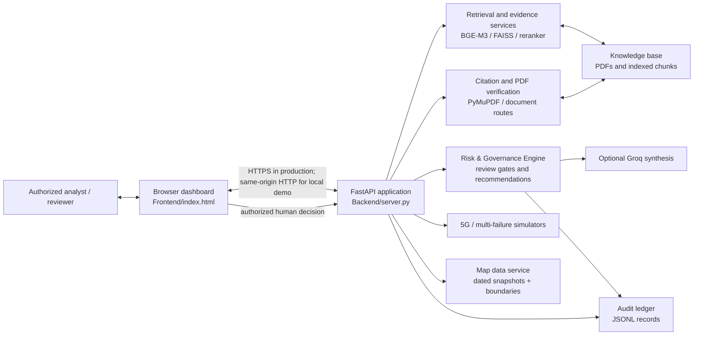
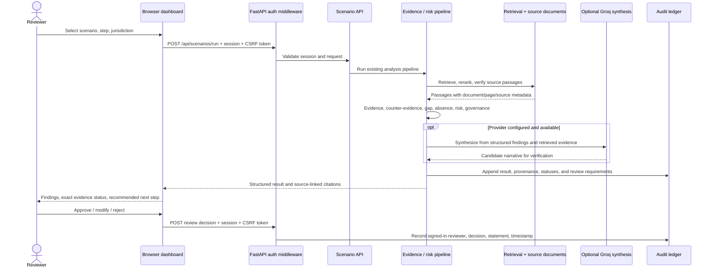

# NetraSetu Technical Design Document

**Status:** design overview of the current repository implementation
**Reviewed:** 27 October 2026
**Scope:** browser dashboard, FastAPI services, evidence retrieval and citation, simulation, governance, and audit.

## 1. System context

NetraSetu is a local-first decision-support prototype. An authenticated user submits an analysis or simulation request in the browser. FastAPI routes it to the existing domain services; evidence-dependent findings carry source metadata into governance and audit records. Human reviewers retain authority over consequential decisions.



## 2. Main analysis flow



An unavailable or unverified passage is not upgraded to an exact citation. A missing result is reported as not retrieved. Synthesis is downstream of evidence assessment; it is not itself the authority for policy or operational action.

## 3. Service responsibilities

| Component | Implementation owner | Responsibility |
|---|---|---|
| Web UI | `Frontend/index.html` | Dashboard navigation, scenario submission, evidence/citation display, review controls, map and latency views. API calls use the served page's origin. |
| Application and API | `Backend/server.py` | FastAPI entry point, session/CSRF middleware, scenario route, health route, failure-combination history and static frontend serving. |
| Pipeline | `Backend/orchestrator.py` and `Backend/evidence_engine/` | Query processing, retrieval/reranking, evidence and counter-evidence analysis, absence/gap checks, citation verification, governance, and synthesis coordination. |
| Retrieval and corpus | `rag/` and `knowledge_base/` | BGE-M3/FAISS retrieval over configured corpus; retrieved text retains source identity and page metadata. Existing index artifacts are runtime dependencies. |
| Source viewer | `Backend/verification_api.py` | Document metadata, PDF preview/raw-document service, and exact quote/clause checks used by the citation viewer. |
| Risk and governance | `Backend/risk_engine/`, `Backend/governance.py`, `Backend/risk_integration_v2.py` | Structured risk assessment, review requirements, escalation, and recommendation fields. Decisions are not executed automatically. |
| Multi-failure simulation | `Backend/telemetry_5g/combination_engine.py` and `Backend/server.py` | Seeded bounded software simulation, scenario metrics including stored p95, and run history. Results are not live network measurements. |
| ECR-5G simulation | `Backend/ecr5g/` | Deterministic packet scheduling / QoS emulator and scenario comparisons; not a controller or conformance certification. |
| Uttarakhand map | `Backend/disaster_map_api.py`, `Backend/disaster_map_data/`, `Backend/disaster_map_boundaries/` | Dated source records and boundary data. Snapshot reports are not live incident feeds or proof of a geographic hazard perimeter. |
| Dharali aftermath evidence | `Backend/aftermath_api.py`, `Backend/dharali_evidence.py` | BM25 search across the checked-in GSI and NRSC/NDEM incident PDFs, page-linked result records, and governance/audit integration. |
| Audit | `Backend/audit/recorder.py`, `Backend/audit_api.py` | Run provenance and human-review record persistence/query/export. Local audit and simulator JSONL records are runtime data and are excluded from Git. |
| Inter-agency coordination | `Backend/coordination_api.py` | Run-linked local message records/proposals. The prototype does not send messages to external agencies. |

The source ownership map is maintained in [engine-source-of-truth.md](architecture/engine-source-of-truth.md). It records additional module-level dependencies and known limitations.

## 4. Evidence and citation path

1. The API validates the signed-in session; state-changing calls also require the session CSRF token.
2. Retrieval searches only configured, ingested/indexed sources. The application records the retrieved document identity and available page/line metadata.
3. Reranking and the evidence engine classify supporting, limiting, counter, insufficient, or conflicting passages. Retrieval failure does not establish that a rule is absent.
4. The citation verifier checks a candidate quotation against the source document. The PDF viewer can open the identified document/page; a citation is not presented as verified when source text cannot be resolved.
5. Governance is computed from structured findings. Any accountable authority must be supported by evidence; otherwise it remains not retrieved.
6. The result and authorized reviewer action are written to the audit service. A user-facing recommendation does not itself authorize field action.

## 5. Simulation and map boundaries

- Failure-combination and ECR-5G outputs are reproducible software simulations. Their p95 values describe the simulated cases; they are not measured operator/network performance.
- The Uttarakhand map uses bundled administrative boundaries and source-dated PWD, USDMA, and GSI snapshots. Missing flood, fire, or risk coverage is left unavailable/unclassified, not treated as safe.
- The Dharali incident query window is 1–30 August 2025. The included GSI and NRSC/NDEM PDFs describe a historic 5 August event; this is not daily coverage or live facility status. Mapped checkpoints are not claims that four facilities were damaged.
- MapLibre uses OpenStreetMap tiles for the basemap; tile availability depends on network access and the tile provider's usage policy.

## 6. Authentication, deployment, and persistence

For local development, the repository's Windows launchers start FastAPI on `127.0.0.1:8000` and the static frontend on `127.0.0.1:5500`. FastAPI also serves `/frontend/` on its own origin. Production configuration must use `NETRASETU_ENV=production`, a configured administrator username and Argon2id PHC hash, and HTTPS terminated by trusted deployment infrastructure. See [SECURITY_DEPLOYMENT.md](../Backend/SECURITY_DEPLOYMENT.md).

Authentication sessions are in memory and expire after 30 minutes. They are lost on process restart and are not shared among multiple workers. The prototype does not include a persistent shared session store, TOTP/passkeys, CAPTCHA, or production TLS termination. Do not present it as independently audited or production-certified.

Audit and simulator run records are local JSONL persistence. They are appropriate for a single-instance demonstration; multi-instance deployments need an explicitly designed shared, durable store and operational retention controls. Secrets, local profile files, generated indexes, and runtime records must not be committed.

## 7. Main HTTP interfaces

| Method / route | Purpose |
|---|---|
| `GET /api/health` | Application health. |
| `GET /api/scenarios` | Scenario catalogue. |
| `POST /api/scenarios/run` | Evidence-grounded scenario step. |
| `GET /api/documents/info`, `GET /api/documents/preview`, `POST /api/verify_claim` | Source lookup, PDF viewing, and quote verification. |
| `GET /api/5g/failure-combinations/catalog`, `POST /api/5g/failure-combinations`, `GET /api/5g/failure-combinations` | Multi-failure catalogue, run, and stored history. |
| `/api/ecr5g/*` | ECR-5G simulation and report routes. |
| `GET /api/disaster-map/data` | Source-dated map data and boundary metadata. |
| `GET /api/aftermath/incident-sources/dharali-2025`, `POST /api/aftermath/incident-analysis` | Dharali evidence sources and bounded search/analysis. |
| `GET /api/audits`, `GET /api/audits/{audit_id}`, `POST /api/audits/{audit_id}/review` | Audit history, record detail, and human review. |
| `GET /api/coordination/messages`, `POST /api/coordination/messages` | Local inter-agency message records. |

Route definitions are authoritative in the FastAPI application and included routers; check `/openapi.json` for the route set running in a particular deployment.

## 8. Verification

Focused checks for the current work:

```powershell
python -m pytest Backend/tests/test_aftermath_api.py Backend/tests/test_failure_combination_engine.py -q
node --test Frontend/tests/disaster_map.test.js Frontend/tests/ecr5g.test.js Frontend/tests/gap_analysis.test.js Frontend/tests/latency_chart.test.js
```

See [Sample Data and Test Cases](SAMPLE_DATA_AND_TESTS.md) for the broader test map and cautions on benchmark snapshots.
